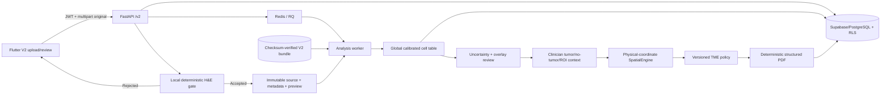

# TME-Insight V2 architecture

TME-Insight V2 is a pathologist-assisted H&E nuclei and spatial TME workflow. The localized `tme_nuclei_v2` release is the default runtime. Predicted neoplastic nuclei never establish tumor presence by themselves.

## Runtime



Production uses Redis/RQ. A single-thread local executor exists only when `ENV != production`.

## V2 analysis sequence

```mermaid
sequenceDiagram
    actor P as Pathologist
    participant F as Flutter
    participant A as FastAPI
    participant D as PostgreSQL/storage
    participant Q as RQ worker
    participant M as TME-Nuclei V2

    P->>F: Select original H&E source and optional MPP
    F->>A: POST /v2/sessions/{id}/analysis
    A->>A: Verify JWT, role, and patient ownership
    A->>A: Decode + deterministic H&E compatibility gate
    alt Unsupported source
        A-->>F: 422 UNSUPPORTED_NON_HE_IMAGE
    else H&E-compatible source
    A->>D: Persist exact bytes, SHA-256, metadata, queued run
    A->>Q: Enqueue analysis_run_id only
    A-->>F: 202 analysis_run_id
    end
    loop Real stage polling
        F->>A: GET /v2/analysis/{run_id}
        A-->>F: stage, progress, tile counts or output
    end
    Q->>D: Reload and checksum source
    Q->>Q: QC and explicit scale resolution
    Q->>Q: Physical resampling when scale is trusted
    Q->>Q: Tissue mask and overlapping 256×256 tiles
    Q->>M: Manifest normalization + dense TorchScript batches
    M-->>Q: NP, HV, NT, contour, seed, features, context
    Q->>Q: Watershed + 132-D classifier + fusion + calibration
    Q->>Q: Cross-tile stitching and source transforms
    Q->>D: Cells, summaries, overlay, diagnostics
    Q-->>F: Nuclei review; tumor remains unconfirmed by default
    P->>F: Confirm tumor/no tumor or annotate tumor region
    F->>A: POST tumor-context
    A->>D: Reuse stored cells; no neural rerun
    A->>A: SpatialEngine + TMEPolicy
    A-->>F: Canonical TME state and valid physical metrics
```

## Scientific state rules

- Biological classes are exactly `NEOPLASTIC`, `INFLAMMATORY`, `CONNECTIVE`, `DEAD`, and `EPITHELIAL`.
- `UNCERTAIN` is an acceptance/review state, not a biological class.
- Unsupported non-H&E uploads are rejected before persistence, run creation, or inference; worker QC repeats the check for older/retried assets.
- Physical coordinates, distances, and densities are null when scale is untrusted.
- `HOT`, `COLD`, and `EXCLUDED` require QC, trusted scale, confirmed tumor, and sufficient accepted cell evidence.
- Confirmed no tumor produces `NOT_APPLICABLE`.
- Technical limitations produce `NOT_ASSESSABLE`.
- Insufficient biological evidence with tumor present produces `INDETERMINATE`.
- None of those states are silently coerced into another state.

## Persistence

The additive migration is [20260827_tme_insight_v2.sql](../Backend/migrations/20260827_tme_insight_v2.sql). It preserves V1 tables and adds:

- `model_versions`
- `image_assets`
- `analysis_runs`
- `cell_instances`
- `tumor_assessments`
- `spatial_analysis_results`
- `tme_assessments`
- `analysis_artifacts`

Ownership RLS flows through `analysis_runs → biopsy_sessions → patients`. Backend routes also verify ownership before using the service-role client.

## API

The V2 router exposes analysis start/status, paginated cells, quality, artifacts, overlay, tumor context, spatial results, recomputation, and protected structured reports under `/v2`.

Historical biopsy sessions resolve to their latest TME-Insight analysis run through the authenticated analysis API.

## Reporting boundary

V2 reports use structured persisted facts. They include source quality/scale, all counts, uncertainty, tumor provenance, spatial measurements, TME policy provenance, limitations, and model hashes. They do not diagnose, establish tumor presence, recommend therapy, or predict treatment response.

## Release gates still external to this repository

- Publisher notebook fixture parity
- GPU load/parity when GPU deployment is used
- Staging Supabase migration/RLS validation
- Redis worker kill/restart validation
- External breast/scanner/stain clinical validation

Legacy deletion is intentionally blocked until these gates pass.
